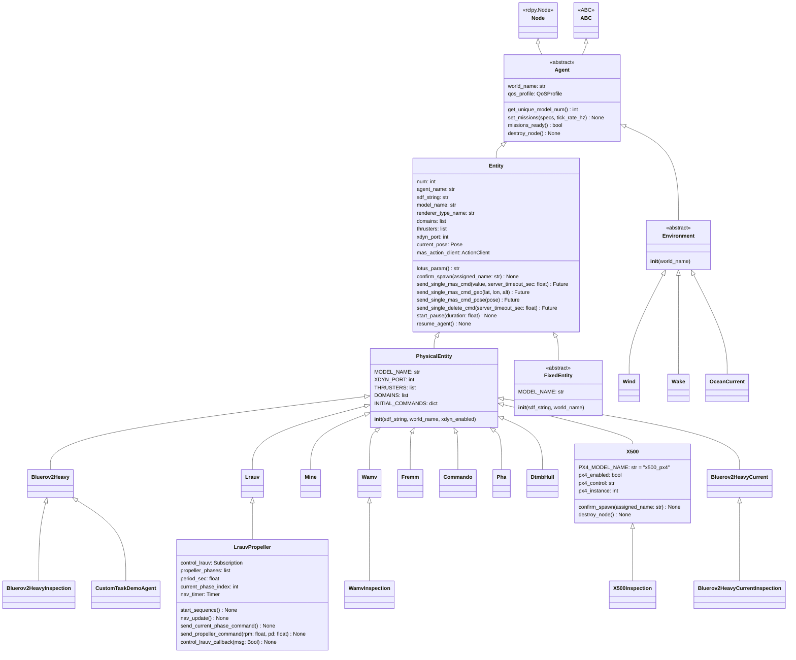
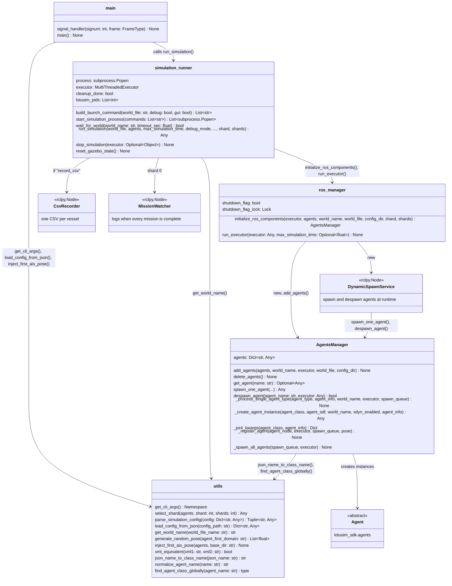
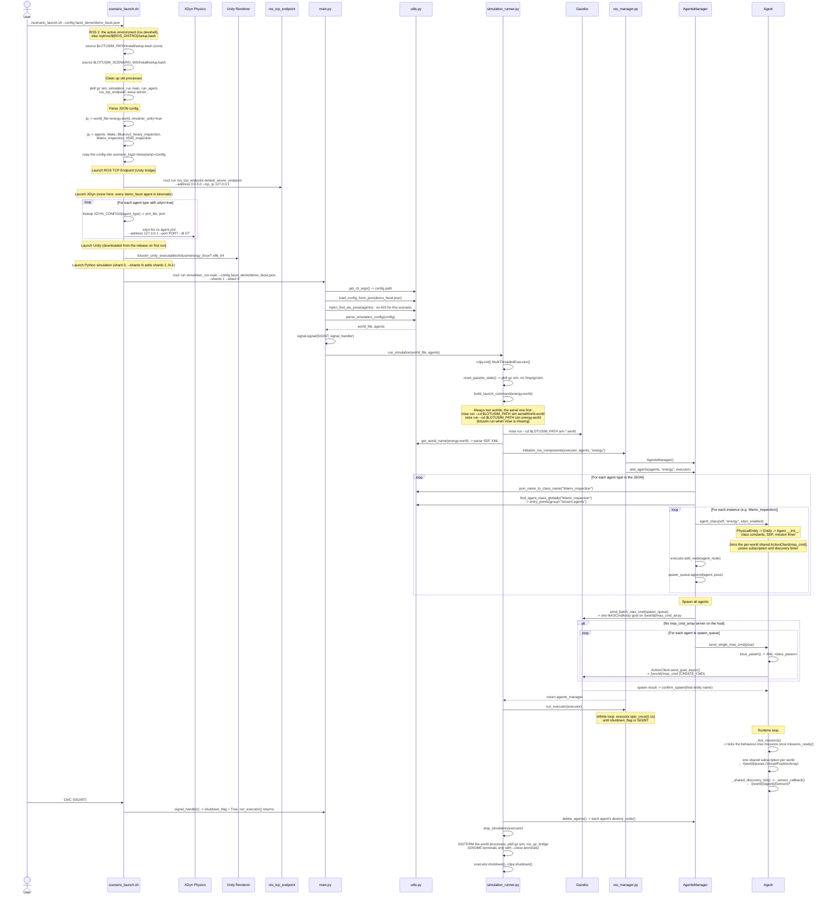
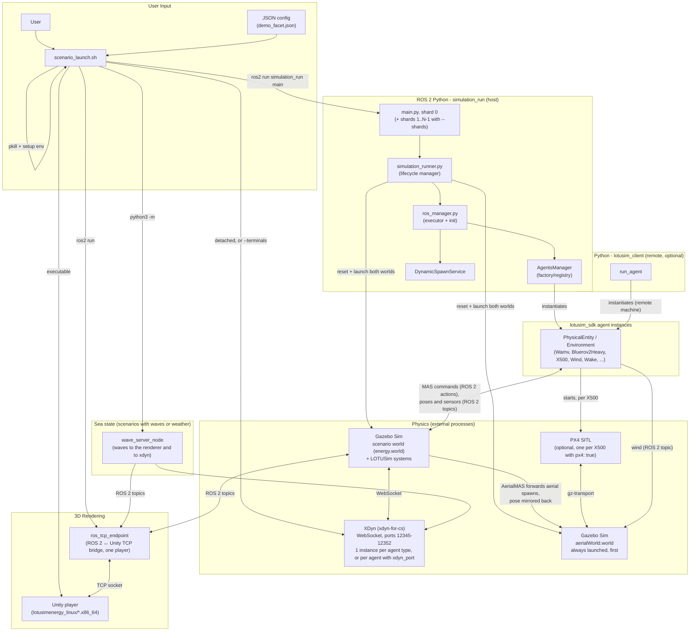

# LOTUSim-generic-scenario - Documentation

## 1. Project Overview

**LOTUSim Generic Scenario** is a multi-agent maritime simulator built on the following stack:

- **ROS 2** (Jazzy) for inter-process communication
- **Gazebo Sim** for physics simulation and the 3D world, with two worlds per run: the scenario world (e.g. `energy`) and `aerialWorld`
- **XDyn** for the hydrodynamic model (Surface/Underwater, `xdyn-for-cs` over WebSocket)
- **PX4 SITL** (optional) as the autopilot of `X500` drones
- **Unity** (optional) for high-fidelity 3D rendering via `ros_tcp_endpoint`

The project simulates naval and offshore-energy scenarios with surface vehicles (Wamv, Fremm, Commando, Pha, DtmbHull), underwater vehicles (Lrauv, Bluerov2Heavy, Mine), aerial vehicles (X500), and environment agents (Wind, Wake, OceanCurrent).

> This workspace is a **ROS 2 overlay** on top of the core LOTUSim (`$LOTUSIM_PATH`, the LOTUSim clone). The core provides the Gazebo systems, the SDF/3D assets, and the custom messages (`lotusim_msgs`, `lotusim_sensor_msgs`).

---

## 2. Package Tree (`src/`)

| Package               | Language | Role                                                                                    |
|-----------------------|----------|-----------------------------------------------------------------------------------------|
| `lotusim_sdk`         | Python   | **The SDK** - agent class hierarchy, behaviour-tree engine, built-in tasks (GNC, inspection, PX4 offboard) |
| `simulation_run`      | Python   | **Host orchestrator** - entry point, lifecycle management, agent spawning, dynamic spawn service |
| `lotusim_client`      | Python   | **Remote launcher** - `run_agent` runs an agent from another machine against the host simulation |
| `external_packages/*` | Python   | **Vehicle packages** - thin vehicle subclasses (`*_inspection`, `lrauv_propeller`, `custom_task_demo`) and vehicle-specific GNC (`*_gnc`) |
| `gz_ros2_bridge`      | C++      | **Gazebo -> ROS 2 bridge** - simulation statistics (`stats_gz_to_ros_bridge`)         |

### Detailed structure of `simulation_run/`

```txt
simulation_run/
├── config/                     # Scenario JSON, grouped by subject
│   ├── basic_examples/         # Behaviour-tree fundamentals
│   ├── current_examples/       # Ocean-current models
│   ├── wind_wake_examples/     # Wind, wake, PX4 aerial drones
│   ├── wave_examples/          # Sea states shared by hulls and renderer
│   ├── multi_vehicle_examples/ # One scenario per vehicle class
│   ├── example_rosbag/         # Recording a ROS 2 bag
│   ├── facet_demo/             # Full-fleet turbine inspection
│   ├── iros_demo/              # The demo scenario (59 agents)
│   └── waypoints/              # Patrol waypoint data files
├── executable/
│   ├── scenario_launch.sh      # Bash entry point (the script to run)
│   └── fetch_unity_player.sh   # Downloads the Unity player of players.json
└── simulation_run/
    ├── main.py                 # Python entry point (ros2 run simulation_run main)
    ├── simulation_runner.py    # Full lifecycle orchestration, launches the Gazebo worlds
    ├── ros_manager.py          # ROS 2 component init, executor loop
    ├── agents_manager.py       # AgentsManager: JSON -> agent classes -> instances -> spawn
    ├── utils.py                # CLI args, JSON/SDF parsing, class discovery, shard selection
    ├── configs.py              # Re-exports WaypointFollowerConfig from the SDK
    ├── csv_recorder.py         # CsvRecorder: one CSV per vessel ("record_csv")
    ├── mission_watcher.py      # MissionWatcher: logs when every mission is complete
    ├── prepare_weather.py      # Builds the sea state for xdyn and the renderer
    ├── wave_server_node.py     # Publishes the waves, rewrites them when the weather changes
    └── dynamic_spawn/          # DynamicSpawnService: spawn/despawn into a running simulation
```

The agent classes themselves live in `lotusim_sdk/lotusim_sdk/agents/` (see section 3).

---

## 3. Class Diagram - Agent Hierarchy (`lotusim_sdk.agents`)

This diagram shows the inheritance hierarchy of agents, from the SDK base classes to the vehicle packages.



`Agent`, `Entity`, `PhysicalEntity`, `FixedEntity`, `Environment` and the vehicle and environment classes are in `lotusim_sdk`. The classes at the bottom come from `external_packages/` (`bluerov2_heavy_inspection`, `wamv_inspection`, `x500_inspection`, `custom_task_demo`, `bluerov_gnc`, `lrauv_propeller`).

### Agent summary table by domain

| Domain          | Vehicle classes (`MODEL_NAME`, `XDYN_PORT`)                                                         | Physics                          |
|-----------------|------------------------------------------------------------------------------------------------------|----------------------------------|
| **Underwater**  | `Bluerov2Heavy` (`bluerov2_heavy`, 12347), `Lrauv` (`lrauv`, 12346), `Mine` (`mine`, 12350)         | XDyn, or Kinematic               |
| **Surface**     | `DtmbHull` (`dtmb_hull`, 12345), `Wamv` (`wamv`, 12348), `Fremm` (`fremm`, 12349), `Pha` (`pha`, 12351), `Commando` (`commando`, 12352) | XDyn, or Kinematic |
| **Aerial**      | `X500` (`x500`, no XDyn)                                                                             | `aerialWorld` (optionally flown by PX4 SITL) |
| **Environment** | `Wind`, `Wake`, `OceanCurrent`                                                                       | no model, they publish the environment |

### Common pattern for vehicle classes

Each concrete vehicle class declares **only class-level constants** (`MODEL_NAME`, `XDYN_PORT`, `THRUSTERS`, `DOMAINS`), with no `__init__` override:

1. `PhysicalEntity.__init__()` reads the constants and wires XDyn, or for `Aerial` the ROS 2 physics connection to `aerialWorld`
2. `Entity.__init__()` sets up the SDF string, pose tracking, and the MAS command client shared per world
3. `Agent.__init__()` starts the behaviour-tree mission timer
4. `lotus_param()` builds the `<lotus_param>` XML sent with the spawn command

`X500` is the only vehicle with its own `__init__`: it adds the PX4 SITL lifecycle (see `doc/PX4_DRONES.md`).

### Dynamic discovery mechanism

Agent classes are **discovered at runtime** via **entry points** (group `lotusim.agents`). Each package declares its classes in `setup.py` -> `entry_points`: `lotusim_sdk` for the base vehicles and environment agents, each `external_packages/*` package for its own. `simulation_run.utils.find_agent_class_globally()` and `lotusim_client`'s `run_agent` load a class by normalized name. Behaviour-tree tasks are discovered the same way (group `lotusim.tasks`).

---

## 4. Class Diagram - `simulation_run` Package

This diagram details the orchestration modules and their relationships.



### Orchestration flow explanation

The `simulation_run` package runs in **3 phases**: startup, runtime, and shutdown. A scenario can be split across several agent processes (`--shards N`): shard 0 starts the Gazebo worlds and the scenario-wide observers, the other shards only host their share of the agents and join the running world. Here is the precise call order between modules:

#### Phase 1 - Startup (from `main.py` to agent spawning)

1. **`main.main()`** is the Python entry point, launched by `ros2 run simulation_run main`.
   - Calls `utils.get_cli_args()` to parse `--config`, `--debug`, `--gui`, `--shards` and `--shard`
   - Registers a signal handler on `SIGINT` (Ctrl+C) and `SIGTERM` (`kill`), so that both shut down cleanly
   - Calls `utils.load_config_from_json()` to load the JSON file, and `utils.inject_first_ais_pose()`
   - Calls `utils.parse_simulation_config()` to extract `world_file` and `agents`
   - Hands off to `simulation_runner.run_simulation()`

2. **`simulation_runner.run_simulation()`** orchestrates the complete lifecycle:
   - Initializes `rclpy` (the ROS 2 Python client library) and creates a `MultiThreadedExecutor` (the ROS 2 executor that runs all agent nodes in parallel)
   - Shard 0 only: calls `reset_gazebo_state()` -> kills old `gz sim` processes and removes `/tmp/gz/sim`
   - Extracts the `world_name` from the `.world` file via `utils.get_world_name()` (parses the SDF XML to retrieve the `name` attribute of the `<world>` tag)
   - Shard 0: calls `build_launch_command()` -> builds the `mise run --cd $LOTUSIM_PATH sim *.world` commands (always 2: the hardcoded `aerialWorld.world` first, then the scenario's world). Without mise and a core clone it falls back to the nix-installed `lotusim run`. Then `start_simulation_process()` launches Gazebo detached, or in separate terminals with `scenario_launch.sh --terminals`
   - Other shards: `wait_for_world()` waits for shard 0's world instead
   - Adds a `CsvRecorder` node if the scenario has `"record_csv"`
   - Hands off to `ros_manager.initialize_ros_components()` for agent initialization
   - Shard 0: adds a `MissionWatcher` node, which logs when every agent's mission is complete

3. **`ros_manager.initialize_ros_components()`** initializes the ROS 2 graph:
   - Creates an `AgentsManager` and calls `AgentsManager.add_agents()` with this shard's agents
   - Creates the `DynamicSpawnService` node, which spawns and despawns agents in the running simulation

4. **`AgentsManager.add_agents()`** iterates over each agent entry of the JSON:
   - For each entry: calls `_process_single_agent_type()` which:
     - Converts the JSON name to a Python class name via `utils.json_name_to_class_name()` (e.g., `"Dtmb_hull"` -> `"DtmbHull"`)
     - Dynamically loads the class via `utils.find_agent_class_globally()` (lookup in the entry points, group `lotusim.agents`)
     - For each instance: calls `_create_agent_instance()` (with `_px4_kwargs()` for classes that accept PX4 parameters), sets the agent's missions, then `_register_agent()` adds the node to the executor and to the spawn queue
   - Once all agents are created: calls `_spawn_all_agents()` -> sends every **`MASCmd.CREATE_CMD`** in one `MASCmdArray` goal (`/{world}/mas_cmd_array`), or one `send_single_mas_cmd()` per agent when the host has no array server. Each result calls the agent's `confirm_spawn()` with its final entity name

#### Phase 2 - Runtime (main loop)

1. **`ros_manager.run_executor()`** enters the main loop:
   - Calls `executor.spin_once(timeout_sec=0.1)` in a loop
   - The executor runs all registered nodes: each agent ticks its behaviour-tree missions once `missions_ready()` (spawn confirmed and own pose received), and reads its pose and sensors through the subscriptions shared per world
   - The loop stops when `shutdown_flag = True`, `rclpy.ok() = False`, or `max_simulation_time` is reached

#### Phase 3 - Shutdown (cleanup)

1. When the user presses **Ctrl+C** (or sends `SIGTERM`):
   - `main.signal_handler()` sets `shutdown_flag = True`, so `run_executor()` returns
   - The `finally` block of `run_simulation()`:
     - Calls `agents_manager.delete_agents()` -> each agent's `destroy_node()` (an `X500` also stops its PX4 SITL process)
     - Closes the `CsvRecorder` and `MissionWatcher` nodes
     - Calls `stop_simulation()`, which terminates the Gazebo processes and the bridge, shuts down the executor, then calls `rclpy.shutdown()`

### Role of `utils.py` and `configs.py`

- **`utils`** is a cross-cutting utility module used by `main`, `simulation_runner`, and `AgentsManager`. It is not part of the sequential flow; it is called on demand for: loading JSON, parsing SDF XML, selecting a shard's agents, generating random poses, and dynamically discovering agent classes.
- **`configs.py`** only re-exports `WaypointFollowerConfig`, which now lives in the SDK (`lotusim_sdk/tasks/waypoint_follower.py`).

---

## 5. Sequence Diagram - Launching the `facet_demo/demo_facet.json` scenario

This diagram shows **everything that happens** when the user enters:

```bash
./src/simulation_run/executable/scenario_launch.sh --config facet_demo/demo_facet.json
```



---

## 6. Global Architecture Diagram

Full system view showing all processes, their interconnections, and the protocols used.



`gz_ros2_bridge`'s `stats_gz_to_ros_bridge` is not started by any scenario launch path; it has its own launch file (`launch/bridge_nodes.launch.py`).

---

## 7. ROS 2 Nodes, Topics, and Actions Architecture

### Nodes

| Node                                     | Description                                                                                                      |
|------------------------------------------|------------------------------------------------------------------------------------------------------------------|
| `/wamvinspection0_3f9a1c2b`, `/wind`...  | One Python node for **each** instantiated agent (inherits from `rclpy.node.Node` via the `Agent` class). An entity's node is named after its class and number plus a random suffix; its entity name (the JSON `id` plus its index, e.g. `x500_px40`) is set afterwards. An environment agent's node is its class name. |
| `/{world}/mas_node`                      | `MultiAgentSystem` (or `AerialMAS`): spawns and deletes the entities of the world.                               |
| `/{world}/physics_plugin`                | `PhysicsInterfacePlugin`: links each entity to its physics engine (XDyn, Kinematic, or the aerial world).        |
| `/physics_aerial_linker`                 | `ROS2Interface`: receives the poses of the aerial world for the mirrored aerial entities.                       |
| `/{world}/render_interface`              | `RenderPlugin`: publishes what Unity needs to create and move the 3D models.                                     |
| `/{world}/{world}_sensor_system`         | Global node managing the sensors integrated in Gazebo.                                                           |
| `/{world}/{world}_power_manager`         | Power subsystem (batteries).                                                                                      |
| `/{world}/waypoint_follower`             | `WaypointFollowerPlugin`: trajectory following inside Gazebo for the agents that use it.                         |
| `/aerialWorld/wind_regions_plugin`       | Applies the wind and the wind regions in the aerial world.                                                        |
| `DynamicSpawnService`, `CsvRecorder`, `MissionWatcher` | Host-side nodes of `simulation_run` (section 4).                                                  |

### Topics

| Topic                                | Message Type                          | Used By                                                            |
|--------------------------------------|---------------------------------------|--------------------------------------------------------------------|
| `/{world}/poses`                     | `lotusim_msgs/VesselPositionArray`    | Pose tracking for all agents (one shared subscription per world)   |
| `/{world}/renderer_poses` & `renderer_cmd` | `lotusim_msgs/...`              | Rendering data exchanges needed for Unity                          |
| `/{world}/vessel_cmd_array`          | `lotusim_msgs/VesselCmdArray`         | Low-level thruster commands (rpm, pitch/diameter)                  |
| `/{world}/{agent}/control_lrauv`     | `std_msgs/Bool`                       | Starts or stops the `LrauvPropeller` sequence                      |
| `/{world}/{vessel}/ais_sensor/ais`   | `lotusim_sensor_msgs/AIS`             | Publication of AIS data (lat, lon, SOG, heading)                   |
| `/{world}/{vessel}/imu_sensor/IMU`   | `sensor_msgs/Imu`                     | Basic inertial data (dynamically discovered)                       |
| `/{world}/{vessel}/waypoint_reached` | `lotusim_msgs/WaypointFollowerStatus` | Waypoint crossing notification + path status                       |
| `/{world}/{vessel}/camera`           | `sensor_msgs/Image`                   | Raw video stream from onboard cameras                              |
| `/aerialWorld/wind`                  | `lotusim_msgs/Wind`                   | Wind vector, written by the `Wind` agent, applied in the aerial world |
| `/defenseScenario/sim_stats`         | `lotusim_msgs/SimStats`               | Simulation timing, from `stats_gz_to_ros_bridge` (topic name hardcoded there; not started by the launcher) |

### Actions and Services

| Interface Name                | Design Pattern | Type / Msg                        | Used For                                                                                                        |
|-------------------------------|----------------|-----------------------------------|-----------------------------------------------------------------------------------------------------------------|
| `/{world}/mas_cmd_array`      | **Action**     | `lotusim_msgs/action/MASCmdArray` | Spawn or delete a batch of agents in one request. The default spawn path.                                        |
| `/{world}/mas_cmd`            | **Action**     | `lotusim_msgs/action/MASCmd`      | Spawn ("CREATE_CMD") or delete ("DELETE_CMD") a single agent. Used when the host has no `mas_cmd_array` server, and by `AerialMAS` to forward to `/aerialWorld/mas_cmd`. |
| `/{world}/{vessel}/waypoints` | **Service**    | `lotusim_msgs/srv/SetWaypoints`   | Used by the vessel agent to upload its list of waypoints to the Gazebo waypoint follower plugin.                |
