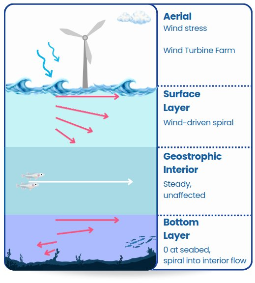

# Ocean current

How a scenario sets the ocean current. Which mechanism applies depends on the
vehicle's physics:

| Vehicle | Current from | Set by |
|---|---|---|
| xdyn vessel | Its xdyn model (an `ekman current` in its YAML) | The model file in the core; for `Bluerov2_heavy_current`, the top-level `bluerov_current` picks it |
| xdyn vessel | A random current injected by the simulator | The agent's `gauss_markov_current` |
| xdyn vessel | A measured depth profile replayed by the simulator | The agent's `copernicus_current`, or the top-level `weather` with a place and date ([Waves and weather](sea.md)) |
| Kinematic vehicle | One uniform current vector | An `OceanCurrent` agent, below |




*The layered Ekman current of the xdyn models: a wind-driven surface layer, a steady interior, and a bottom layer that vanishes at the seabed. From [LOTUSim-Energy, IROS 2026 workshop](https://hal.science/hal-05741707).*

## For the BlueROV2: `bluerov_current`

The top-level `bluerov_current` picks the xdyn model of every
`Bluerov2_heavy_current` agent:

| Value | Current |
|---|---|
| `"ekman"` (default) | xdyn's Ekman current, from `BlueROV2_current_ekman.yml` |
| `"gauss"` | None in the model: give the agent a `gauss_markov_current` |
| `"copernicus"` | None in the model: give the agent a `copernicus_current` |
| `"none"` | No current |

```json
"bluerov_current": "gauss",
"agents": [
  { "id": "rov", "class": "Bluerov2_heavy_current", "xdyn": true,
    "gauss_markov_current": { "mean_x": 0.20, "mean_y": 0.08, "tau": 60.0, "std_dev": 0.05, "seed": 1 } }
]
```

| `gauss_markov_current` key | Default | Meaning |
|---|---|---|
| `mean_x`, `mean_y` | `0` | Mean current, m/s |
| `tau` | `60` | Correlation time, s |
| `std_dev` | `0` | Standard deviation around the mean, m/s |
| `seed` | `0` | Random seed |

`copernicus_current` has one key, `profile`: a CSV of
`depth_m, vx_north_ms, vy_east_ms`, relative to the scenario file. The two
are alternatives; an agent with both keeps the Gauss-Markov one. Eight ready
scenarios: `current_examples/`.

## For Kinematic vehicles: the `OceanCurrent` agent

An `Environment` agent (`lotusim_sdk.agents.environment.ocean_current.OceanCurrent`),
declared like any other agent in the `"agents"` list, applied by
`KinematicInterface` to every **Kinematic**-connected entity (vehicles
running `waypoint_follower`/`waypoint_follower_avoidance`, and any prop using
`kinematic_anchor` — [Task reference](tasks.md)):

```json
{ "class": "OceanCurrent", "id": "ocean_current0", "x": 0.05, "y": 0.12, "z": 0.0 }
```

| Field | Type | Default | Meaning |
|---|---|---|---|
| `x`, `y`, `z` | float (m/s) | `0.0` | World-frame ENU current velocity (x=East, y=North, z=Up), added on top of each agent's own commanded velocity every physics step. |
| `publish_rate_hz` | float | `1.0` | How often the held vector is republished (latched, so late subscribers get it regardless of rate). |

This is deliberately **not xdyn**: xdyn-connected agents get a
physically-simulated current from their own hydrodynamic config instead (a
separate, unrelated mechanism). `OceanCurrent` only feeds the Kinematic
path, which is what `waypoint_follower`-driven scenarios actually use, since
that task always forces a Kinematic spawn regardless of the `xdyn` scenario
flag. An agent is on exactly one interface at a time, so there's no
double-current risk switching between them.

Because `waypoint_follower`/`waypoint_follower_avoidance` is a closed-loop
pursuit controller (it re-reads the agent's actual pose every control tick),
the current shows up as transient drift the guidance loop keeps correcting
for — visible in the CSV's `cross_track_error_m` column ([Recording](recording.md)) — rather than
an ever-growing offset. A `kinematic_anchor`-only prop (no guidance loop at
all) just drifts steadily in the current's direction.

`z` is carried through the message and reported in the CSV, but
`KinematicInterface::getNewState` (`physics_engine_interface/kinematic_interface.cpp`,
`LOTUSim` repo) only integrates position in x/y + yaw, so it currently
has no physical effect — reserved for a future vertical-current extension.
The ROS-side wiring that feeds the plugin — subscribing to
`/<world>/ocean_current` and calling `KinematicInterface::setCurrent()` — is
deliberately kept in its own class/translation unit, `OceanCurrentFeed`
(`ocean_current_feed.hpp`/`.cpp`), rather than inlined into
`PhysicsInterfacePlugin::Configure()`: an optional demo mechanism, not
something every scenario wants, so it's one line to construct
(`physics_interface_plugin.cpp`) and easy to drop entirely without touching
any of the shared plugin code.

The agent continuously republishes its held vector, latched
(`lotusim_msgs/OceanCurrent`, TRANSIENT_LOCAL) on `/<world>/ocean_current`, so
the host plugin (and Unity, for current-vector display) picks it up
regardless of process startup order. Being a normal `Environment` agent, it
also goes through `AgentsManager.delete_agents()` on scenario shutdown, which
calls its `destroy_node()` override — publishing a disabled
(`enable_current=False`) message before going away, so nothing is left
showing/applying a stale current from a scenario that has already ended (the
same problem `Wind` solves for its region boxes, [Wind and wake](wind.md)).
