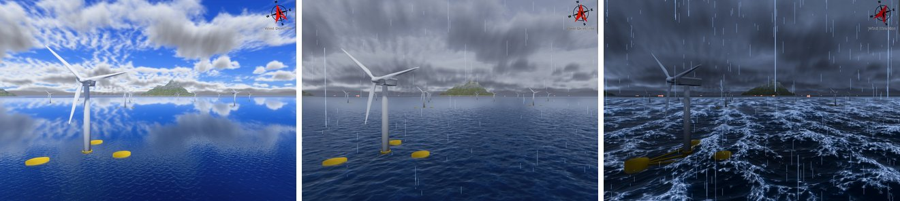

# Waves and weather

One sea for every vessel and the renderer.




*The offshore farm in the renderer, from calm weather to a storm. From [LOTUSim-Energy, IROS 2026 workshop](https://hal.science/hal-05741707).*

Without these blocks each xdyn model keeps the wave settings of its own YAML:
every vessel draws its own random sea, and the renderer draws yet another one
from the wind. With either block, the launcher builds the wave components of
the scenario's sea state **once** (`lotusim_sdk.waves`) and gives the same
list to every xdyn model and to the renderer:

- **Fixed sea (the default).** `simulation_run.prepare_weather` writes the components to
  `$LOG_DIR/waves/wave_rays.csv` and copies every xdyn model there with the
  wave model `spectra from a list of rays` / `rays from file`. **xdyn computes
  the waves itself**, with its own Airy model, on those components.
- **Live sea** (`"live": true`, `"follow_wind": true` or a `"schedule"`).
  The model copies keep the same rays file, with `reload rays file: true`.
  At each change of the sea state, the scenario's wave server
  (`simulation_run.wave_server_node`) rewrites it, with four fade columns per
  component (`fade_in_start`, `fade_in_duration`, `fade_out_start`,
  `fade_out_duration`, in simulation time), and every xdyn re-reads it (it
  checks the file every 200 ms). xdyn weights each component by
  `sqrt(u_in (1 - u_out))`, so the variance of the surface moves linearly from
  the old sea to the new one; a live sea therefore costs xdyn what a fixed one
  does, except during a ramp. The node computes no physics.

In both cases `wave_server_node` publishes the components on
`/<world>/wave_spectrum` (`lotusim_msgs/WaveSpectrum`, transient local), and
the Unity 6 player draws them on the ocean (`XdynWaveSurface`), with the same
fades, at the current simulation time, and places every vessel at that same
time (its pose extrapolated from the two newest pose messages): one sea, crest
for crest, in the physics and in the images, with no added display delay.
Inside the 2048 m region around the camera HDRP's own swell is masked out;
beyond it, HDRP's swell carries the same Hs, Tp and direction to the horizon.

```json
"waves": { "hs_m": 0.5, "tp_s": 3.0, "gamma": 1.2, "direction_deg": 0.0, "spreading_s": 2.0, "seed": 2 }
```

| Key | Default | Meaning |
|---|---|---|
| `hs_m` | 0.5 | Significant wave height (m) |
| `tp_s` | 3.0 | Peak period (s) |
| `gamma` | 1.2 | JONSWAP peak enhancement factor |
| `direction_deg` | 0.0 | Direction the waves travel to, from north towards east |
| `spreading_s` | 2.0 | cos-2s directional spreading exponent |
| `seed` | 2 | Seed of the component frequencies and phases |
| `nfreq`, `ndir` | 32, 8 | Frequency bins and directions of the discretisation |
| `omega_min`, `omega_max` | 0.5 and 3 times `2 pi / tp_s` | Frequency range (rad/s) |
| `frequency_jitter` | true | One frequency at random inside each bin (else at its centre) |
| `energy_fraction` | 0.99 | Components kept, by decreasing amplitude, until this fraction of the energy |
| `depth_m` | 0 | Water depth for the dispersion relation (0: deep water) |
| `live` | false | The sea can change during the run (the rays file is rewritten and re-read, see above) |
| `shared` | true | `false`: every model and the renderer each draw their own random sea of this spectrum, with other phases (the behaviour without the shared sea, kept as a baseline) |

The amplitudes are rescaled so that the kept components have exactly `hs_m`.
Frequencies are **not** evenly spaced: with a common spacing `d_omega`, the sea
would repeat itself every `2 pi / d_omega` seconds (about 20 s with the old
16 frequencies over 0.1–4 rad/s). With the defaults a sea has about 140
components.

```json
"weather": { "beaufort": 4, "direction_deg": 90.0 }
```

`beaufort` (0–12) gives `hs_m` from the WMO table, `tp_s = 4.4 sqrt(hs_m)`
(inside the JONSWAP range `3.6 sqrt(hs_m) <= tp_s <= 5 sqrt(hs_m)` of
DNV-RP-C205), and `gamma` 3.3. Force 0 is a flat sea. Any key of the table
above overrides the derived value.

The same force sets the wind and the current. `wave_server_node` publishes the
10 m wind U10 of the force on `/aerialWorld/wind`, blowing towards the waves'
direction (`"wind": false` turns it off). Each xdyn model's `ekman current`
receives that wind and the latitude of the world, and derives its top layer from
it (`layer thickness follows wind`: `D = 7.6 U10 / sqrt(sin|latitude|)`).
`"currents": false` leaves the models' own current; `"current"` (interior
current), `"seabed_m"` and `"bottom_layer_m"` override the values of the YAML.

```json
"weather": { "date": "2024-08-10T12:00", "place": { "lat": 50.25, "lon": -4.25 } }
```

`date` and `place` set the weather measured there and then, from the
Copernicus Marine Service (nearest time step, then nearest sea point):

| | Product | What is used |
|---|---|---|
| Waves | GLOBAL_ANALYSISFORECAST_WAV_001_027 (3-hourly, 1/12°) | `hs_m`, `tp_s`, mean direction (converted from "coming from" to "going to"); `gamma` 3.3 |
| Current | GLOBAL_ANALYSISFORECAST_PHY_001_024 (6-hourly, 1/12°) | Profile of `uo`, `vo` down to 200 m, written to `$LOG_DIR/waves/current_profile.csv` and replayed by the physics plugin for **every xdyn vehicle** that declares no current of its own (the models' own `ekman current` is removed from the copies, so the current is not applied twice). `"currents": false` keeps the models' currents. |
| Wind | WIND_GLO_PHY_L4_NRT_012_004 (hourly, 1/8°) | 10 m wind, published once a second on `/aerialWorld/wind` by `wave_server_node`: the drones' wind plugin and the renderer read it. `"wind": false` turns it off (and leaves the topic to a `Wind` agent or the sliders). |

The values are downloaded once with the `copernicusmarine` tool (`pip install
copernicusmarine`, then `copernicusmarine login`; it is run with
`$LOTUSIM_COPERNICUS_PYTHON`, default `/usr/bin/python3`) and cached in
`$LOTUSIM_WEATHER_CACHE` (default `~/.cache/lotusim/weather`), so later runs
read the same weather offline, without an account.

**Changing the sea during the run** (live sea only). Publish a JSON object
with the keys of a `waves` or `weather` block, plus an optional `ramp_s`
(default 60), on `/<world>/sea_state`:

```bash
ros2 topic pub --once /energy/sea_state std_msgs/msg/String '{data: "{\"beaufort\": 5, \"ramp_s\": 20}"}'
```

or script it in the mission file:

```json
"weather": { "beaufort": 3, "ramp_s": 30, "schedule": [ { "t_s": 80, "beaufort": 5 } ] }
```

The old sea fades out while the new one fades in over `ramp_s` seconds of
simulation time, in xdyn and in the renderer alike, with amplitude gains
`sqrt(1 - u)` and `sqrt(u)`: the variance of the surface moves linearly from
the old sea to the new one (linear gains would leave half the energy halfway
between two equal seas). The wind and xdyn's Ekman current move over the same
ramp, linearly (xdyn re-reads `$LOG_DIR/waves/ekman_weather.csv`). The current of
a date, replayed by the physics plugin, does not follow a change. A request for the sea already running is ignored; on
a fixed sea it is refused with a warning. With `"follow_wind": true`, each
change of the Beaufort force of `/aerialWorld/wind` changes the sea the same
way, the waves travelling with the wind. Note that the Unity wind sliders
publish their (zero) wind when the player joins: with `follow_wind`, the sea
of the mission file then fades to force 0 unless the sliders are moved.

**Live sea and real time.** xdyn evaluates a live sea from the same rays file
as a fixed one, so it costs the same except during a ramp, while the two seas
are summed.

**Checking the rendered sea.** With the player argument `-xdynHullProbe <s>`
(`UNITY_EXTRA_ARGS`), the player logs, every `<s>` seconds and for every surface
vessel, the water it draws under the hull next to the hull's height and the
elevation of the shared components (`[WaterHullProbe] t, name, east, north,
hull_up, rendered_up, components_up`). The launcher copies the player's log to `$LOG_DIR/unity_Player.log` at the end of
the run. Examples: `config/wave_examples/` (the same WAM-V mission with the
shared sea of a date, with unshared seas, and with a scheduled change from
force 3 to 5).

**Known warning.** xdyn reports that about 1300 facets of the WAM-V pontoon
mesh "seem oriented inwards". The mesh is closed and every facet points out of
its own pontoon (checked: positive volume per pontoon); xdyn's check looks
from the centre of the whole mesh, which lies between the two pontoons.
