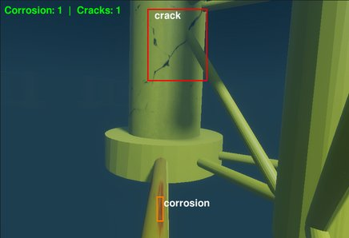
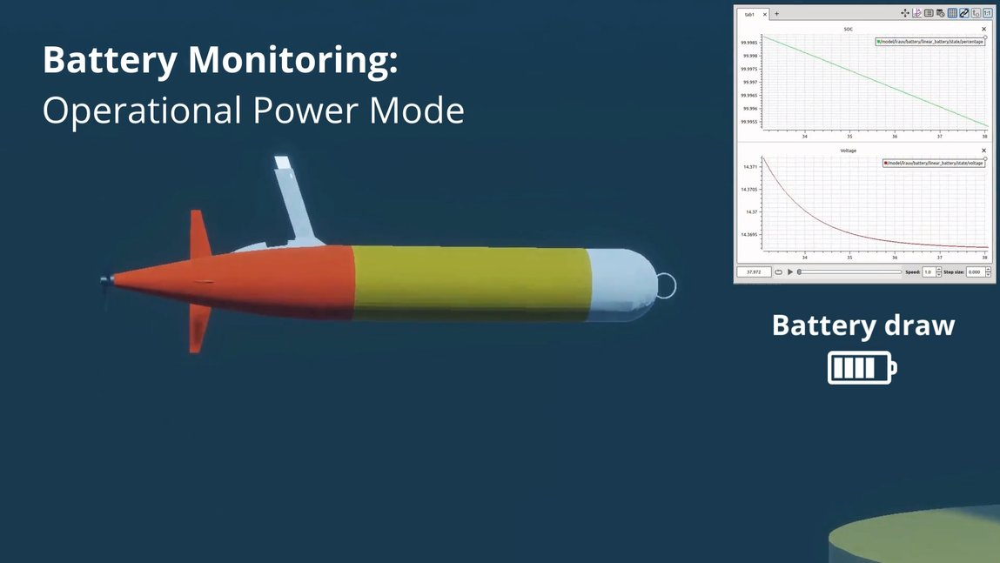

# Inspection and battery tasks

Tasks that run a detector on the vehicle's camera, or watch its battery.

## `fault_inspection` → `FaultInspectionTask`

Corrosion and crack detection on the vehicle's camera images (colour
thresholds and a YOLO detector). It never finishes; detections are published
as the images arrive.

| Param | Type | Default | Notes |
|---|---|---|---|
| `show_window` | bool | `false` | Opens a live OpenCV debug window with annotated detections. Requires a GUI-capable display on the machine actually ticking this task (host or remote) — leave `false` on a headless box. |

Subscribes `/{world}/{agent}/inspection/image`
(`sensor_msgs/CompressedImage`); publishes JSON detections on
`/{world}/{agent}/inspection/detections` (`std_msgs/String`,
`TRANSIENT_LOCAL`).

*Detections of `fault_inspection` on a monopile: one crack, one corrosion patch. From [LOTUSim-Energy, IROS 2026 workshop](https://hal.science/hal-05741707).*

## `check_battery_state` → `CheckBatteryStateTask`

Lights the vehicle's status light while its battery is above a threshold.
It never finishes, and sends a command only when the state changes.

| Param | Type | Default | Notes |
|---|---|---|---|
| `threshold` | float (%) | `80.0` | Battery percentage above which the light turns ON. |

Subscribes `/{world}/{agent}/battery/state` (`sensor_msgs/BatteryState`,
`TRANSIENT_LOCAL`); publishes `/{world}/{agent}/light/cmd` (`std_msgs/Bool`,
`TRANSIENT_LOCAL`). Requires the spawned model to bundle a `battery_sensor`
+ `light_actuator` (e.g. `model-battery.sdf`).

*A vehicle's battery state during a mission, from its battery sensor. From [LOTUSim-Energy, IROS 2026 workshop](https://hal.science/hal-05741707).*

## `crack_detector` → `CrackDetector`

Crack detection with a YOLO detector on the vehicle's camera images. It never
finishes. The detector loads on the first image, on the GPU when CUDA is
available, otherwise on the CPU.

| Param | Type | Default | Notes |
|---|---|---|---|
| `model` | string | `"simulation"` | Detector weights to load: `"simulation"` or `"real"` |
| `show_window` | bool | `false` | Opens a window with the annotated images. Needs a display on the machine running the task |

Subscribes `/{world}/{agent}/inspection/image` (`sensor_msgs/CompressedImage`);
publishes JSON detections on `/{world}/{agent}/inspection/detections`
(`std_msgs/String`, `TRANSIENT_LOCAL`). Example:
`basic_examples/custom_task_demo.json`.

## `blink_light` → `BlinkLightTask`

Blinks the vehicle's status light, forever. Shipped by the
`custom_task_demo` package, as an example of a task that lives outside the
SDK; usable on any agent whose model has the light actuator
(`model-battery.sdf`).

| Param | Type | Default | Notes |
|---|---|---|---|
| `period_s` | float (s) | `1.0` | Half-period of the blink |
