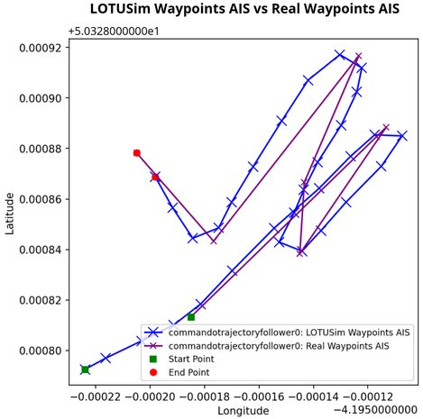

# Patrol tasks

Tasks that move a vehicle along waypoints with LOTUSim's own kinematic
guidance, without the navigation, guidance and control pipeline.

## `waypoint_follower` → `WaypointFollowerTask`

Closed-loop guidance to a list of waypoints, run **on the agent node**
(works identically host-side or remote — see
[`MISSIONS.md` §4.3](../MISSIONS.md#43-worked-example--waypointfollowertask)).
Returns `RUNNING` until within `range_tolerance` of the final waypoint (then
`SUCCESS`, unless `loop: true`, which never terminates); `FAILURE` if no
waypoints could be resolved.

| Param | Type | Default | Notes |
|---|---|---|---|
| `waypoints` | `[{"lat","lon"}, ...]` | — | Inline list. Takes priority over `waypoints_file`. |
| `waypoints_file` | string | — | Patrol-file name, resolved via `PatrolFileProvider` relative to the scenario JSON's own directory (`_config_dir`) — same format as [`waypoints/waypoint_windturbine1.json`](../../src/simulation_run/config/waypoints/waypoint_windturbine1.json) (`{"mmsi": ..., "waypoints": [{"timestamp","lat","lon"}, ...]}`). |
| `loop` | bool | `true` | Loop back to the first waypoint after the last, forever (`RUNNING` never ends). |
| `control_rate_hz` | float | `20.0` | Frequency of the guidance/control loop (independent of `tick_rate_hz`, which only paces the BT `tick()`). |
| `guidance_mode` | `"bang_bang"` \| `"pid"` | `"bang_bang"` | Controller family for both linear and angular velocity. |
| `range_tolerance` | float (m) | `0.5` | Distance to a waypoint at which it counts as reached. |
| `linear_velocities_limits` | `[min, max]` (m/s) | `[0.0, 15.0]` | Forward speed bounds. |
| `linear_accel_limit` | float (m/s²) | `0.5` | Forward acceleration limit. |
| `angular_velocities_limits` | float (rad/s) | `0.05` | Max yaw rate. |
| `angular_accel_limit` | float (rad/s²) | `0.5` | Yaw acceleration limit. |
| `angular_pid` | `[kp, ki, kd]` | `(0.8, 0.05, 0.4)` | Only meaningfully tunable; used by both guidance modes for heading control. |

Requires the world's geographic origin to be available (`host._world_origin`)
to project `lat`/`lon` waypoints into the same ENU frame Gazebo uses — see
[the host world origin](scenario_file.md#world-origin) (host, automatic) and [the remote world origin](remote.md#world-origin-must-be-supplied-explicitly) (remote, via `--origin`/config `origin`).




*A patrol recorded from a real ship's AIS (purple) and the same patrol followed in LOTUSim (blue). From [LOTUSim-Energy, IROS 2026 workshop](https://hal.science/hal-05741707).*

## `waypoint_follower_avoidance` → `WaypointFollowerAvoidanceTask`

`WaypointFollowerTask` plus a fake sonar and obstacle avoidance. Same params
and semantics as `waypoint_follower` above (it's a subclass — every param in
that table also applies here), plus:

| Param | Type | Default | Notes |
|---|---|---|---|
| `sonar_range_m` | float (m) | `40.0` | Detection range AND the distance over which avoidance strength ramps to zero — one knob, no separate "avoidance radius". |
| `obstacle_prefixes` | `[string, ...]` | `["mine"]` | Agent-name prefixes treated as obstacles (matched against live names on `/<world>/poses`, e.g. a `"mine"`-classed agent spawns as `mine0`, `mine1`, ...). |
| `avoid_gain` | float | `1.5` | Repulsion weight relative to the (unit) goal direction. |

"Fake sonar" means a ground-truth proximity check against other known
entities' poses (`host.poses_of_others()`) — not a simulated acoustic/Gazebo
sensor. Avoidance only ever bends the **steering bearing**: the nearest
in-range obstacle's repulsion vector is blended with the true goal direction
before the (otherwise unchanged) bang-bang/PID heading controller runs;
arrival detection, speed ramp, and the CSV recorder's
`cross_track_error_m`/arrival columns always use the TRUE goal, so avoidance
never corrupts those metrics — it only changes what heading gets commanded.
See `lotusim_sdk/tasks/waypoint_follower_avoidance.py` for the exact blend.

## `kinematic_anchor` → `KinematicAnchorTask`

Forces a thruster-less prop (e.g. a `mine`-classed agent) onto the
`Kinematic` connection type without ever commanding it to move — otherwise
it gets no connection type at all and the host never integrates it,
including any ocean current ([Ocean current](current.md)). No params; `update()` always returns
`RUNNING`. Give the agent a bare mission using this task and it just sits at
its spawn pose, drifting only as much as the current (if any) pushes it:

```json
{ "id": "obstacle1_anchor", "type": "action", "task": "kinematic_anchor", "params": {} }
```
