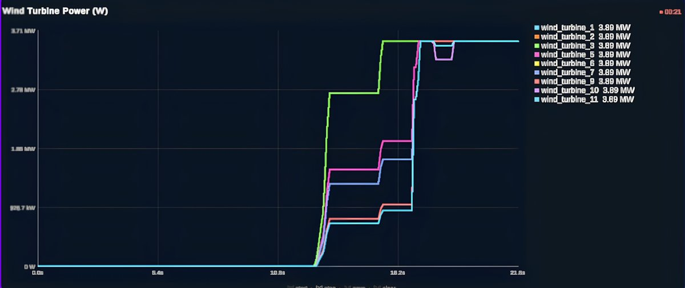
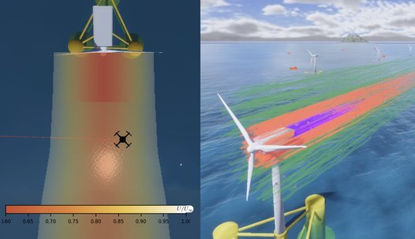

# Wind and wake

How a scenario sets the wind, wind regions and turbine wakes.


*A turbine and the wake region behind it, drawn in the renderer. From [LOTUSim-Energy, IROS 2026 workshop](https://hal.science/hal-05741707).*

The ambient (global) wind hangs off **one topic**, `/aerialWorld/wind`
(`lotusim_msgs/Wind`, an ENU velocity vector in m/s). Hardcoded, like the
aerial world itself. Three parties touch it and none know about each other:

```
Unity wind sliders ─┐
                    ├──> /aerialWorld/wind ──┬──> wind_regions plugin ──> forces on vehicles
Wind agent ─────────┘                        │    (Gazebo, subscribes to
        │                                    │     ROS directly — no bridge)
        │                                    └──> Wake agent ──> /<world>/wind/turbines, /<world>/lcoe
        │                                                     │  (turbine power, farm economics;
        │                                                     │  always reads the ambient vector,
        │                                                     │  never regions)
        │                                                     └──> /aerialWorld/wind/regions
        │                                                          (wind_regions block, optional —
        │                                                          the wake footprint itself, as cones)
        └──> /aerialWorld/wind/regions ──> wind_regions plugin
             (lotusim_msgs/WindRegionArray; Wind's own static `regions`, optional)
```

`/aerialWorld/wind/regions` has **two possible writers** — `Wind` (static
`regions`, below) and `Wake` (dynamic `wind_regions`, further down) — and they
do not know about each other any more than the three parties on the ambient
topic do. See the `Wake` section for why declaring both in one scenario is a
mistake, not a feature.

The aerial world is always started — it is infrastructure, not a scenario
option — and the `wind_regions` Gazebo plugin that lives in it embeds its own
ROS node, so there is no separate bridge process to start or stop. So the only
question a scenario answers is **who writes the topic, and when**.

## `Wind` — writing the ambient wind from a mission, and only then

`Wind` holds one vector and republishes it at `publish_rate_hz` — but **only
while one of its own missions is actively running**. With no `missions`
declared, or once every declared mission has finished (reached
`SUCCESS`/`FAILURE`), it publishes nothing at all on `/aerialWorld/wind`: the
sliders are the only writer on the topic and free hand-tuning behaves exactly
as if no `Wind` agent were declared.

```json
{ "id": "wind", "class": "Wind", "x": 8.0, "y": 0.0, "z": 0.0, "publish_rate_hz": 10.0 }
```

| Field | Type | Default | Meaning |
|---|---|---|---|
| `x` / `y` / `z` | float | `0.0` | Ambient wind velocity in m/s, world ENU frame (x=East, y=North, z=Up), used as the starting held value once a mission claims the topic. |
| `publish_rate_hz` | float | `10.0` | How often the held vector (and the `regions` list below) is republished. |
| `regions` | list | `[]` | Optional 2D wind regions overriding the ambient vector — see below. |

With no `missions` at all (as above) this agent is a **legitimate no-op** for
the ambient vector — sliders are always in control, and `Wake` reads whatever
they publish. That is the right shape for a scenario that only wants wake/LCOE
modelling and free manual wind control, e.g.
[`px4_manual_wake_flying.json`](../../src/simulation_run/config/wind_wake_examples/px4_manual_wake_flying.json).

## `regions` — 2D wind overrides on top of the ambient vector

Each entry is a box `(x1,y1)`–`(x2,y2)` in world ENU X/Y, **all altitudes**
(no `z` bound, matching the ambient wind which has none either). `WindRegion`
also supports a cone-segment shape (used by `Wake`'s `wind_regions` below,
not available here — this static list is always the box shape). Any
wind-enabled link whose world X/Y falls inside a region's box feels that
region's vector instead of the ambient one; outside every region, the ambient
vector applies. On overlap, the **last** region in the list wins.

```json
"regions": [
  { "id": "mirror_test_box", "x1": -20.0, "y1": -20.0, "x2": 20.0, "y2": 20.0, "mirror_global": true }
]
```

| Field | Type | Default | Meaning |
|---|---|---|---|
| `id` | string | `"region_<i>"` | Label, carried through to `WindRegionArray` for Gazebo/telemetry. |
| `x1`,`y1`,`x2`,`y2` | float | — | Box bounds in world ENU X/Y (required). |
| `x`,`y`,`z` | float | `0.0` | Region wind velocity in m/s, ignored if `mirror_global` is set. |
| `mirror_global` | bool | `false` | If set, the published vector is always `-1 *` the current ambient vector instead of `x`/`y`/`z` — tracks the ambient wind live (mission- or slider-driven), useful for exercising the region pipeline with a vector that keeps changing without needing a dedicated task to drive it. |

Unlike the ambient vector, `regions` are published **regardless of mission
state** on `/aerialWorld/wind/regions` (`lotusim_msgs/WindRegionArray`) — a
`mirror_global` region must keep tracking the ambient vector even while
`Wind` is passive and the sliders are driving it, so `Wind` also subscribes to
its own `/aerialWorld/wind` topic to know the value currently in effect no
matter who wrote it. `Wake` is unaffected by `regions` — turbines always read
the ambient vector only.

To actually script the wind, give `Wind` `missions` built from `set_wind` and
`wait` ([Missions](missions.md)):

```json
{
  "id": "wind", "class": "Wind", "x": 8.0, "tick_rate_hz": 1.0,
  "missions": [{
    "id": "shift", "type": "sequence", "children": [
      { "id": "east",  "type": "action", "task": "set_wind", "params": { "x": 8.0, "y": 0.0 } },
      { "id": "hold",  "type": "action", "task": "wait", "params": { "duration_s": 30.0 } },
      { "id": "north", "type": "action", "task": "set_wind", "params": { "x": 0.0, "y": 14.0 } }
    ]
  }]
}
```

The topic is claimed **the instant `missions` is set** — a mission root
defaults to `RUNNING` before its very first tick, so there is no gap where the
sliders could sneak in a value right as the mission starts. The moment the
whole tree reaches a terminal status, publishing stops and the sliders regain
the topic on the next slider move — no scenario restart needed.

Note this is a **one-way** interface: nothing pushes state back into Unity, so
while a mission is active a `set_wind` task changes the physics and the wake
model but does **not** move the Unity sliders or refresh their vector-field
display. Unity keeps showing whatever was last set there by hand, even though
its writes are (until the mission ends) not the ones taking effect.

## `Wake` — reading the wind, per-turbine power and LCOE



*The power of each turbine, as `Wake` publishes it, while the wind rises. From [LOTUSim-Energy, IROS 2026 workshop](https://hal.science/hal-05741707).*


`Wake` applies a wake model over a turbine layout and publishes
`lotusim_msgs/WindTurbineArray` on `/<world>/wind/turbines`. With an `lcoe`
block it also publishes `lotusim_msgs/LCOEState` on `/<world>/lcoe`.

```json
{
  "id": "wake", "class": "Wake",
  "wake_model": "larsen",
  "diameter": 61.0, "ct": 0.8, "cp": 0.35,
  "air_density": 1.225, "cut_in": 5.0, "cut_out": 25.0,
  "ambient_ti": 0.08, "shear_exponent": 0.12,
  "maintenance_cost": 100000.0,
  "lcoe": { "alpha_r_aud_per_hour": 50.0, "alpha_e_aud_per_kwh": 0.5, "publish_rate_hz": 1.0 },
  "turbines": [ { "name": "wind_turbine_1", "x": 307.5, "y": -29.5, "z": 85.03 }, "..." ]
}
```

| Field | Type | Default | Meaning |
|---|---|---|---|
| `wake_model` | string | `"larsen"` | Wake model to apply. `"larsen"` is currently the only one. |
| `diameter` | float | `61.0` | Rotor diameter in m. |
| `ct` / `cp` | float | `0.8` / `0.35` | Thrust and power coefficients. |
| `air_density` | float | `1.225` | kg/m³. |
| `cut_in` / `cut_out` | float | `5.0` / `25.0` | Operating wind speed range in m/s; outside it a turbine produces 0 W. |
| `ambient_ti` | float | `0.08` | Ambient turbulence intensity as a fraction. Drives how fast a wake widens and mixes out — raise it and downstream turbines recover more. |
| `shear_exponent` | float | `0.12` | Power-law wind shear exponent (IEC 61400-1). The inflow is averaged over the rotor disk through this profile, so each turbine's own hub height (`z`) affects its power. |
| `maintenance_cost` | float | `100000.0` | Per turbine per year, spread over the run's duration for LCOE. |
| `model_params` | dict | `{}` | Extra keyword arguments passed straight to the model class — for parameters specific to one model. `larsen` needs none. |

**The wake model is `larsen`** — a semi-analytical Larsen (2009) wake, ported
from the IRL Crossing benchmark repository
([`lotusim-wake-models`](https://github.com/IRL-Crossing-CNRS/lotusim-wake-models)),
where it was validated against OpenFOAM v8 + turbinesFoam actuator-line CFD.
It beats Jensen and FLORIS-Gauss on every power protocol there (baseline RMSE
0.212 MW against 0.309 MW for Jensen and 0.767 MW for FLORIS-Gauss). Two
things worth knowing before you
trust a number it gives you:

- Its centreline deficit is an **empirical fit calibrated on the NREL 5MW**
  (D=126 m) at 7D–9D spacing. The default LOTUSim layout is D=61 m at 100 m
  spacing — about 1.6D, well inside the near wake and outside the calibrated
  range. Expect it to stay closer than Jensen there, but it is not validated
  in that range.
- There is **no rated-power ceiling**: the power curve stays cubic all the way
  to `cut_out`, matching the reference implementation. At high wind speeds a
  turbine will report well above its nameplate rating, which flatters LCOE.

LCOE lives inside `Wake` rather than in an agent of its own because it is a
direct integral of the turbine power computed there — it needs no input the
wake model does not already have. Robots are found on their own: any
`*/battery/state` topic is picked up automatically, so there is no agent list
to keep in sync. Drop the `lcoe` block and the economics are simply off.

### `wind_regions` — the wake footprint as cone segments a vehicle actually feels



*The wake as the wind field sees it (left, velocity deficit) and as wind regions (right). From [LOTUSim-Energy, IROS 2026 workshop](https://hal.science/hal-05741707).*


```json
"wind_regions": {
  "cell_diameters": 0.5,
  "deficit_threshold": 0.05,
  "max_downstream_diameters": 8.0,
  "direction_hysteresis_deg": 5.0,
  "speed_hysteresis_mps": 0.5
}
```

With this block, `Wake` also publishes `lotusim_msgs/WindRegionArray` on
`/aerialWorld/wind/regions` — the same topic the `wind_regions` Gazebo plugin
already reads for the ambient/static-region mechanism described above, so a
wind-enabled vehicle flying behind a turbine feels a real velocity deficit
instead of the ambient vector everywhere.

`WindRegion` supports a second shape besides the static box above: a tapered
cone segment (`origin`, unit downstream `axis`, `length`, `r_start`, `r_end`),
tested with a closed-form point-in-cone check on the Gazebo side — no box
approximation. Each turbine's wake is represented as a handful of these
segments **chained end to end** (one segment's `r_end` is the next one's
`r_start`), so the geometry itself is one continuous tapered cone rather than
stacked rectangles — see
[`wake_regions.py`](../../src/lotusim_sdk/lotusim_sdk/agents/environment/wake/wake_regions.py)
for how the chain is built. This requires `wake_model: "larsen"` (the block
wraps a `BlendedWakeModel` around the same `LarsenWakeModel` instance already
computing turbine power, so rotor geometry can't drift between the two).

| Field | Type | Default | Meaning |
|---|---|---|---|
| `cell_diameters` | float | `0.5` | Downstream length of each segment, in rotor diameters — the resolution knob. Independent of `max_downstream_diameters` (the reach knob): halving this doubles the segment count over the same distance instead of shortening it. Because each segment already tapers smoothly (and chains without a seam into the next), this is purely a velocity-gradient granularity knob and not a visual-smoothness one, so it can usually be set coarse. |
| `deficit_threshold` | float | `0.05` | Lateral cutoff used to find each segment's radius — where the deficit falls below this fraction, sideways, is the wake's edge at that distance. In principle also stops the downstream chain once the *centreline* deficit itself falls below it, but see the note below: for the calibrated fit this almost never happens within a farm-sized distance, so `max_downstream_diameters` is what actually stops the chain. |
| `max_downstream_diameters` | float | `8.0` | Hard cap on how far downstream segments are generated, in rotor diameters. **This is the parameter that controls wake length in practice** — tune it to your farm's own turbine spacing. |
| `direction_hysteresis_deg` / `speed_hysteresis_mps` | float | `5.0` / `0.5` | Regions are only recomputed and republished once the wind has drifted past one of these thresholds since the last publish — not on every wind message. |

**`deficit_threshold` will not stop the chain early — plan around
`max_downstream_diameters` instead.** The calibrated centreline deficit is
`0.58 * (x/D)^-0.35` — a power law that decays so slowly it only falls below a
5% relative deficit around `x/D ≈ 1100` (67 km for a 61 m rotor). In practice
every turbine's segment chain runs to the `max_downstream_diameters` cap,
always. Set that cap by hand rather than trusting the threshold to end the
chain for you — for a farm with turbines spaced closer than the cap (common:
this model's own default layout is only 1.6D apart, well inside the 7-9D the
model was validated on), every turbine's chain will run past its downstream
neighbours, and dropping the cap to roughly the farm's own spacing keeps that
visually and computationally sane.

**Performance note.** The `wind_regions` Gazebo plugin re-scans the *entire*
region list for *every* wind-enabled link on *every* physics tick (500 Hz by
default). Region count scales with velocity-gradient granularity rather than
with how smooth the shape needs to look, so `cell_diameters` can usually be
set coarser than a purely visual criterion would suggest — worth tuning it
against a live run rather than assuming the defaults are optimal.

**`Wind` and `Wake` must not both write regions in the same scenario.**
`/aerialWorld/wind/regions` is latched with no merging between publishers —
if `Wind` also declares a static `regions` list, whichever agent publishes
last wins and silently blanks out the other's regions.

Full files: [`px4_manual_wake_flying.json`](../../src/simulation_run/config/wind_wake_examples/px4_manual_wake_flying.json)
(slider-driven wind + wake, `wind_regions` enabled, no LCOE) and
[`demo_facet.json`](../../src/simulation_run/config/facet_demo/demo_facet.json) (wake +
LCOE, no `wind_regions`, alongside the rest of the demo).

`turbines[].{x,y,z}` follow the same ENU convention as every other position in
this document (`z` = height/hub height, `x`/`y` = horizontal plane) — the wake
models consume `x`/`y` as horizontal and `z` as vertical, same as
`wind_speeds_full`'s `wind_vector` argument (`[vx, vy]`, horizontal ENU plane).
This matters because the `wind_regions` Gazebo plugin applies that same
ambient vector directly (it subscribes to `/aerialWorld/wind` itself, no
bridge in between) — if the wake model used a different "up" axis than the
physics engine, the two consumers of one wind vector would silently disagree
about what it means.

## For a vehicle to actually feel the wind

Two things must hold, both of them in the core repo:

- the world loads the `wind_regions` plugin (`assets/worlds/aerialWorld.world`
  does, in place of stock `gz-sim-wind-effects-system`);
- **each link** that should be pushed carries `<enable_wind>true</enable_wind>`.
  A model-level `<enable_wind>` is *not* propagated to links by sdformat14 — it
  parses without a warning and silently does nothing.
